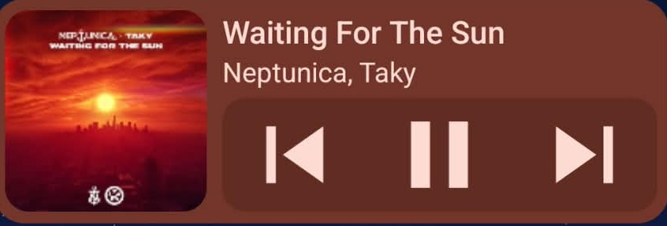

<div align="center">

# Media Widget

**A single-row (4x1) media widget for Android.**

[](https://github.com/Andrew4224/android-media-widget/releases)
[](LICENSE)




</div>

## About

Many media widgets take up at least two rows on the home screen. Media Widget needs only one – and works with any player that supports Android's media controls.

## Features

- Cover art, title, artist and playback controls in a single row
- Adapts its layout to the widget size, from 4x1 down to 1x1
- Opens the player with a tap on the cover or title
- Picks the active player automatically, preferring your favorite (Spotify by default)
- Players you don't want can be turned off in the settings and are then ignored
- Switch between several active players with a button next to the title
- Keeps showing the last track after the player has closed – tap play to resume
- Shows the playback progress as a subtle fill behind the widget, with an adjustable update
  interval (1–10 seconds or off)
- Follows your system colors (Material You)
- No network access, no tracking

## Sizes

The widget can be resized freely and picks the layout that fits:

| Size                     | Layout                            |
|--------------------------|-----------------------------------|
| 4x1 (default) and larger | Cover, title, artist and controls |
| 1x2, 2x2                 | Title, artist and controls        |
| 1x1, 2x1                 | Controls only                     |

The exact switch points depend on the cell size of your launcher.

## Installation

1. Download the latest APK from [Releases](https://github.com/Andrew4224/android-media-widget/releases) and install it.
2. Open **Media Widget** and grant notification access. Android only shares which media is playing with apps that have it – notifications themselves are never read, stored or sent anywhere.
3. Add the widget to your home screen.

> [!NOTE]
> On Android 13 and later, the access may be blocked as a "restricted setting" because the app was
> not installed from an app store. In that case, open the app info of **Media Widget**, tap the
> three-dot menu in the top right corner, choose **Allow restricted settings** and grant
> notification
> access again.

## Troubleshooting

**The widget sometimes stops updating.** Android may be restricting the app in the background. Open
the app info of **Media Widget**, go to **App battery usage** and choose **Unrestricted**. The exact
names can differ depending on your device.

## Known limitations

- Some launchers don't allow widgets to be resized to a single row.
- No seeking. The progress fill moves in steps at the chosen interval while the screen is on and
  unlocked, not continuously.
- Short intervals cost battery: each refresh takes about 0.15 s of CPU time, which adds about 16 %
  load on one CPU core at 1 s and about 3 % at 5 s (measured on a test device).
- If your favorite player has a media session, it is always shown, even if another player is
  active.
- Android sends play to the player that was active last. If that is a turned-off player, the
  widget shows an open symbol instead, and play opens the shown player before playback starts.
- When the player has closed, play resumes the last active player on the device, which may not be
  the one shown.

## Building

Requires JDK 17 or newer and the Android SDK.

```sh
./gradlew assembleDebug
```

## License

[Apache License 2.0](LICENSE)
